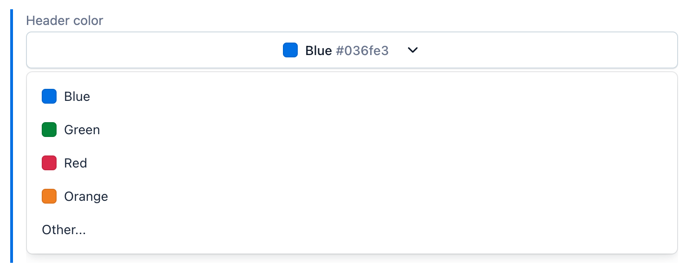

This project was bootstrapped with [Create Contentful App](https://github.com/contentful/create-contentful-app).

[](https://app.contentful.com/deeplink?link=apps&id=4Vy3oAINwRgnxakoTz06tG)

## Overview

The Color Picker app allows you to select colors within Contentful fields.



## Opacity

Enable **Enable opacity** in the app configuration to edit transparency. The setting
(`enableOpacity`) defaults to `false`, including for existing installations.

When enabled, both custom colors and configured swatches use `#RRGGBBAA`: eight hex
digits plus `#`. The popup includes a hue slider, a second slider for opacity, and
Red, Green, Blue, and Opacity (%) numeric inputs. `00` is transparent, `ff` is opaque;
50% opacity is stored as `80` (the nearest alpha byte).
The shared `ColorPicker` component owns the popup and uses `react-colorful`'s
`RgbaColorPicker` with its default styles. Numeric inputs use Forma 36 controls.

Short-text fields store the hex string directly; JSON fields retain the object below,
with an eight-digit hex string in `value`. Existing field values are not rewritten
when the setting changes. Disabling opacity removes alpha from configured swatches
and restores the native color picker. Update any field allowed-value validations
and consumers expecting six-digit hex before enabling opacity.


## JSON response

When assigned to a JSON field, the app stored the value in the following format:

```json
{
  "id": "047d8164-b131-4b9d-80b5-ba06e9ef4cbf",
  "name": "Blue",
  "value": "#0088cc"
}
```