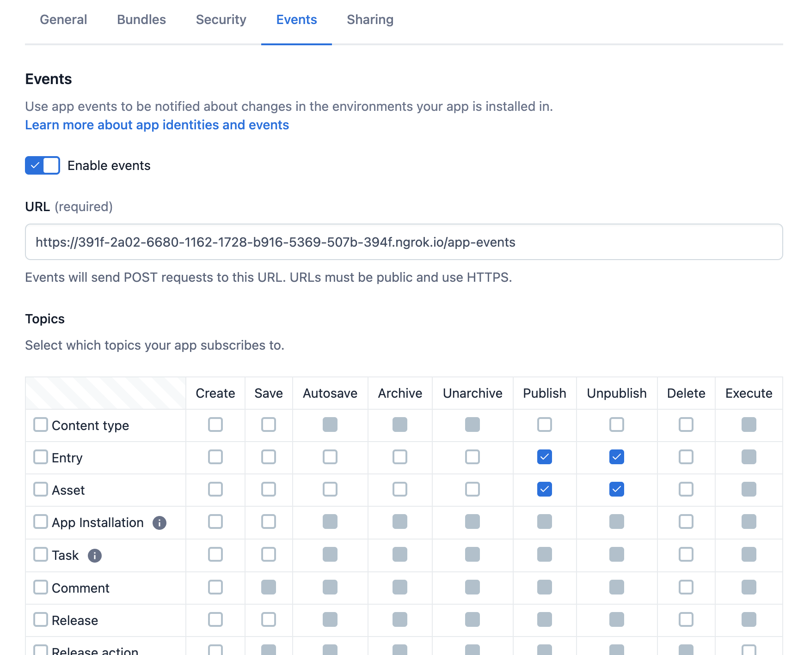

Netlify App
===

## Local Development

The Netlify App is a React app (in `src`) plus two Contentful Functions (in `functions`) which handle
Netlify build hooks:

* `handleNetlifyBuild`: triggered by the `Netlify Build` app action, fires the build hook of one site.
* `appEventHandler`: fires the configured build hooks when Entries or Assets are published/unpublished.

### Launching the app

Run:
```
npm run start
```

### Building

Builds the frontend and the functions into `build/`:

```sh
npm run build
```

### Tests

```sh
npm test
```

### Events

To receive Entry and Asset publish/unpublish events, configure the Events tab of the app definition
so that the events are handled by the `appEventHandler` function:


Now you're all set and can configure your Netlify app and deploy sites!
